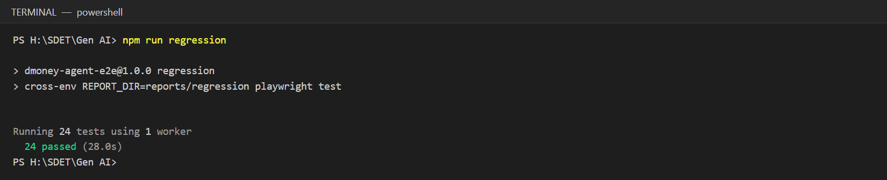
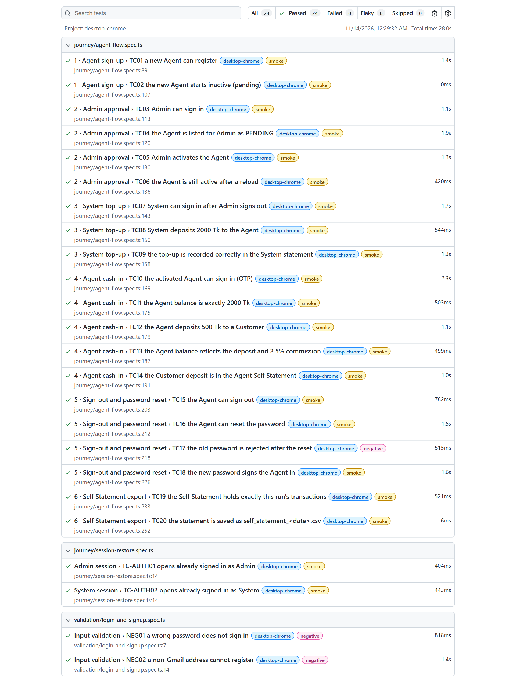
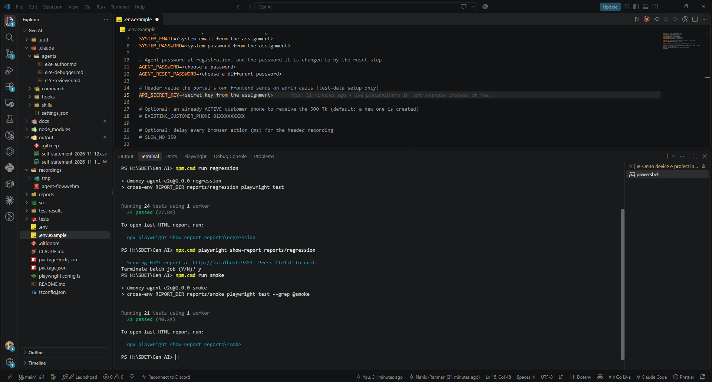
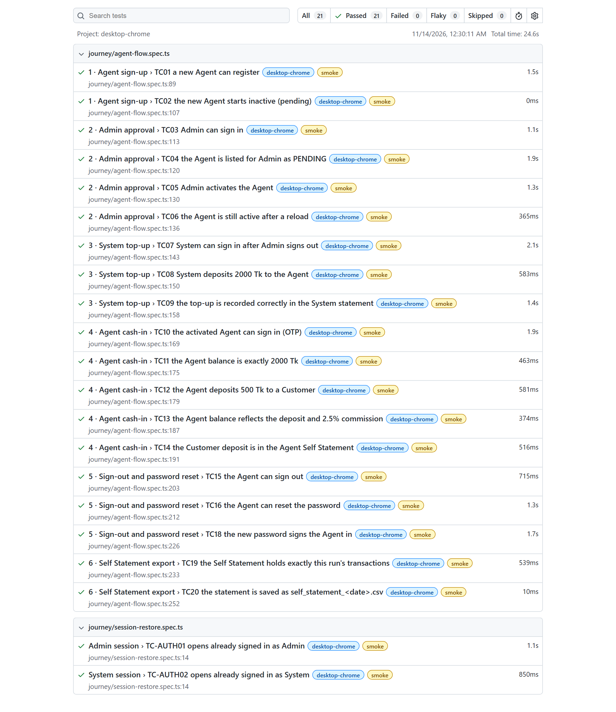
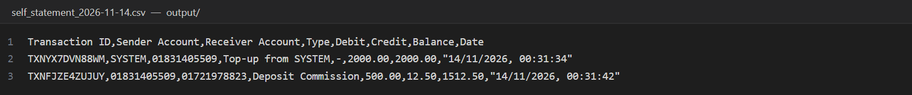

# DMoney Agent Workflow – Playwright E2E

> Student: Shaikh Mahmudur Rahman ID: SMR98787

Automated end-to-end test of the DMoney **Agent** workflow on
[dmoneyportal.roadtocareer.net](https://dmoneyportal.roadtocareer.net), written in **Playwright + TypeScript**,
with a Claude Code AI harness in [`.claude/`](.claude).

Batch 1 · Topic: Playwright

## Contents

* [Workflow covered](#workflow-covered)
* [Required validations](#required-validations)
* [Project layout](#project-layout)
* [Getting started](#getting-started) · [Environment](#environment-env) · [What is git-ignored](#what-is-git-ignored)
* [Regression Test Result](#regression-test-result)
* [SmokeTest Result](#smoketest-result)
* [CSV output](#csv-output)
* [Headed run video](#headed-run-video)
* [AI harness](#ai-harness)
* [Notes on the portal](#notes-on-the-portal)

## Workflow covered

The journey runs as six stages in one browser session (`tests/journey/agent-flow.spec.ts`):

1. **Agent sign-up** – home page -> Sign Up -> register with role *Agent* (TC01–TC02)
2. **Admin approval** – Admin signs in, finds the Agent, activates it (TC03–TC06)
3. **System top-up** – System signs in, deposits **2000 Tk** to the Agent (TC07–TC09)
4. **Agent cash-in** – Agent signs in with OTP, checks **2000 Tk**, deposits **500 Tk** to a Customer (TC10–TC14)
5. **Sign-out and password reset** – sign out, reset password, old one fails, new one works (TC15–TC18)
6. **Self Statement export** – read every row and save `output/self_statement_YYYY-MM-DD.csv` (TC19–TC20)

## Required validations

|#|Validation|Test|Runs in|
|-|-|-|-|
|1|Agent registration is successful|TC01|smoke, regression|
|2|New Agent is initially inactive|TC02|smoke, regression|
|3|Admin login is successful|TC03|smoke, regression|
|4|New Agent appears in the Admin user list|TC04|smoke, regression|
|5|Admin can activate the Agent|TC05|smoke, regression|
|6|Agent remains active after reload|TC06|smoke, regression|
|7|System login is successful|TC07|smoke, regression|
|8|System deposits 2000 Tk to the Agent|TC08|smoke, regression|
|9|System deposit creates the right record|TC09|smoke, regression|
|10|Agent can log in after activation|TC10|smoke, regression|
|11|Agent balance is exactly 2000 Tk|TC11|smoke, regression|
|12|Agent deposits 500 Tk to a Customer|TC12|smoke, regression|
|13|Agent balance updated correctly (1512.50)|TC13|smoke, regression|
|14|Deposit appears in the Agent Self Statement|TC14|smoke, regression|
|15|Agent logout works|TC15|smoke, regression|
|16|Agent password reset works|TC16|smoke, regression|
|17|Old password fails after reset|TC17|regression (negative)|
|18|New password works|TC18|smoke, regression|
|19|Self Statement has the expected data|TC19|smoke, regression|
|20|Self Statement saved to CSV|TC20|smoke, regression|
|+|Wrong password is rejected|NEG01|regression|
|+|Non-Gmail sign-up is blocked|NEG02|regression|
|+|Saved Admin session restores without login|TC-AUTH01|smoke, regression|
|+|Saved System session restores without login|TC-AUTH02|smoke, regression|

**Regression:** 24 tests (`npm run regression`). **Smoke:** 21 positive tests (`npm run smoke`).

## Project layout

```
.
├── .claude/
│   ├── agents/            e2e-author, e2e-reviewer, e2e-debugger
│   ├── commands/          /regression, /smoke, /new-check
│   ├── hooks/typecheck.sh tsc after every .ts edit by Claude
│   ├── skills/dmoney-portal/SKILL.md
│   └── settings.json      allowed commands, .env read blocked, hook registration
├── CLAUDE.md
├── src/
│   ├── core/              settings (validated .env), models, business rules
│   ├── screens/           TopBar + AuthScreen, SignUpScreen, UserAdminScreen, DepositScreen, StatementScreen
│   ├── support/           backoffice (API), factory (test data, dates), csvFile
│   └── fixtures.ts        test.extend with screen fixtures
├── tests/
│   ├── setup/global.setup.ts      saves Admin/System sessions to .auth/
│   ├── journey/agent-flow.spec.ts TC01–TC20
│   ├── journey/session-restore.spec.ts
│   └── validation/login-and-signup.spec.ts
├── output/                CSV from TC20
├── docs/                  screenshots + video for this README
├── playwright.config.ts
└── .env.example
```

## Getting started

Node.js 18 or newer.

```bash
npm install
npx playwright install chromium
cp .env.example .env
```

### Environment (`.env`)

Credentials are never written in code. They are read from `.env`, which is **git-ignored**. Only the
template `.env.example` is committed. Copy it to `.env` and fill in:

|Key|Required|Meaning|
|-|-|-|
|`ADMIN_EMAIL`, `ADMIN_PASSWORD`|yes|Admin login (from the assignment)|
|`SYSTEM_EMAIL`, `SYSTEM_PASSWORD`|yes|System login (from the assignment)|
|`AGENT_PASSWORD`|yes|Password for the new Agent at sign-up|
|`AGENT_RESET_PASSWORD`|yes|New password used in the reset step|
|`API_SECRET_KEY`|yes|Backend secret key, used only for test-data setup and to read the e-mailed OTP/reset token|
|`PORTAL_URL`, `BACKEND_URL`|no|Default to the DMoney portal and backend|
|`EXISTING_CUSTOMER_PHONE`|no|Use this Customer instead of creating a new one|
|`SLOW_MO`|no|Milliseconds between actions, e.g. `350` for a watchable headed run|

If a required key is missing, the run stops at once with `.env is incomplete, missing: ...`.

### What is git-ignored

|Ignored|Why|
|-|-|
|`node_modules/`|restored by `npm install`|
|`.env`, `.env.*` (except `.env.example`)|holds credentials|
|`reports/`, `test-results/`, `blob-report/`, `playwright/.cache/`|generated on every run|
|`.auth/`|saved Admin/System sessions (contain tokens)|
|`recordings/`|raw run videos; the one shown below is copied to `docs/videos/`|
|`.claude/settings.local.json`|personal Claude settings (the rest of `.claude/` **is** committed)|
|`.vscode/`, `.idea/`, `.DS_Store`, `Thumbs.db`|editor/OS files|

|Command|Purpose|
|-|-|
|`npm run regression`|everything; report in `reports/regression/`|
|`npm run regression:headed`|same with a visible browser|
|`npm run smoke`|`@smoke` only; report in `reports/smoke/`|
|`npm run smoke:headed`|same with a visible browser|
|`npm run list`|list tests without running them|
|`npm run typecheck`|TypeScript check|

Every run records the journey to `recordings/agent-flow.webm`. Set `SLOW_MO=350` in `.env` for a watchable recording.

> The portal is a shared live system: each run creates one new Agent and one new Customer.

## Regression Test Result

*Add after running `npm run regression`:*

<!--  -->

<!--  -->

## SmokeTest Result

*Add after running `npm run smoke`:*

<!--  -->

<!--  -->

## CSV output

`output/self_statement_<date>.csv` – columns match the Self Statement table, values are RFC-4180 quoted
(the date contains a comma). TC20 reads the file back and compares it with the table rows.

<!--  -->

## Headed run video

<!-- Copy recordings/agent-flow.webm (or an mp4 export) to docs/videos/ and link it here. -->

## AI harness

|File|What it does|
|-|-|
|`CLAUDE.md`|Commands, layout and rules Claude follows in this repo|
|`.claude/settings.json`|Pre-approved safe commands, blocks reading `.env` and destructive commands, registers the hook|
|`.claude/hooks/typecheck.sh`|After Claude edits a `.ts` file, runs `tsc --noEmit` and returns errors to Claude|
|`.claude/skills/dmoney-portal/SKILL.md`|Portal knowledge: roles, OTP, commission, caps, selectors, pagination|
|`.claude/agents/e2e-author.md`|Writes tests/screen objects to the conventions|
|`.claude/agents/e2e-reviewer.md`|Read-only review: coverage, flakiness, assertions, tags|
|`.claude/agents/e2e-debugger.md`|Diagnoses failures from traces and fixes without weakening assertions|
|`.claude/commands/`|`/regression`, `/smoke`, `/new-check <behaviour>`|

## Notes on the portal

* **Ordered, single session.** Each stage needs the previous one, so the file runs in serial mode with one context (and one video).
* **OTP / reset link** go to a Gmail inbox the suite cannot read. They are fetched via the admin API for the run's own Agent only; all checks happen in the UI.
* **Commission.** The Agent earns 2.5 % on a customer cash-in, so the balance ends at **1512.50** and the statement shows credit 12.50.
* **Customer cap (~10,000 Tk).** A fresh active Customer is created before the journey; override with `EXISTING_CUSTOMER_PHONE`.
* **Statement pagination** counts all-time rows but shows only today's; collection stops at the first empty page.

